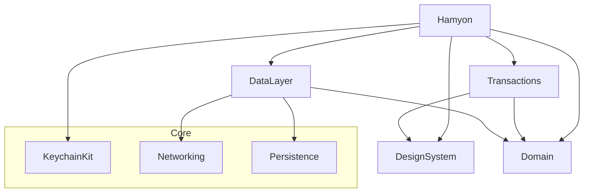

# Hamyon
An iOS app for tracking income and expenses.
## Goal
A learning project to practice senior-level iOS engineering: modular architecture, Swift 6 concurrency and testing.
## Architecture

Domain layer does not depend on any other layers, because it owns the abstraction, the repository protocol, and DataLayer implements it. Domain declares no dependencies, so SPM won't let it import other modules and SwiftLint prevents importing system frameworks such as UIKit, SwiftUI, CoreData etc.

## Tech stack
Swift 6, SPM, Swift Testing, SwiftLint

## Requirements
Xcode 27.2+, iOS 17+

## Getting started
Clone the project: 
```bash
git clone https://github.com/temurz/hamyon-ios.git
```
Open Hamyon.xcodeproj, choose scheme Hamyon, ⌘R.
## Testing & linting
Testing the app: 
```bash
xcodebuild test -scheme Hamyon -destination 'platform=iOS Simulator,name=iPhone 18 Pro'
```
Domain, Core, DataLayer are tested with(run from each package folder, e.g.):
```bash
cd Packages/Domain && swift test 
```
DesignSystem and Features are tested with:
```bash 
cd Packages/DesignSystem && xcodebuild test -scheme DesignSystem -destination 'platform=iOS Simulator,name=iPhone 18 Pro'
```

```bash
cd Packages/DesignSystem && xcodebuild test -scheme Features -destination 'platform=iOS Simulator,name=iPhone 18 Pro'
```

Linter: swiftlint
## Roadmap

- [ ] **Stage 0: Setup.** SPM modules, Git workflow, SwiftLint
- [ ] **Stage 1: Design system.** Tokens, components, snapshot tests
- [ ] **Stage 2: Domain.** Clean Architecture, unit tests, TDD
- [ ] **Stage 3: Persistence.** Core Data, concurrency, migrations
- [ ] **Stage 4: Screens.** UIKit + SwiftUI, MVVM, Coordinators
- [ ] **Stage 5: Networking.** async/await, error handling, caching, Combine
- [ ] **Stage 6: Testing & quality.** UI tests, accessibility
- [ ] **Stage 7: CI/CD.** GitHub Actions, Fastlane, TestFlight
- [ ] **Stage 8: Extras.** Face ID, widget, charts, profiling

